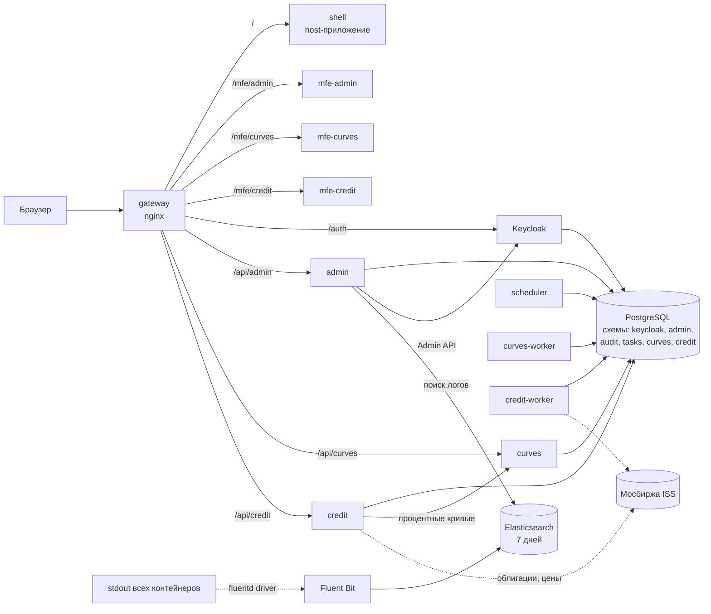

# CDS Pricing

Система прайсинга CDS: микросервисы на Python (FastAPI), UI на Vue 3 с микрофронтендами
(Module Federation), Keycloak, PostgreSQL, Elasticsearch. Запускается одной командой через Docker Compose.

Сейчас реализованы каркас платформы, администрирование и бизнес-сервисы:
**процентные кривые** ([математика](docs/curves-math.md)), **кредитные кривые** по облигациям Мосбиржи
([данные, модель, калибровка](docs/credit-math.md)) и **прайсинг CDS** — СПФИ и внебиржевые сделки со Сбером
([конвенции, модель, CDS-кривые](docs/cds-pricing.md)).

## Быстрый старт

Нужны Docker с Compose v2 и Python 3 (только для генерации секретов).

```bash
python scripts/gen-env.py
```

```bash
docker compose up -d --build
```

Откройте http://localhost:8080 и войдите как `admin` с паролем `CDS_BOOTSTRAP_ADMIN_PASSWORD`
из `.env` — при первом входе система попросит задать свой пароль. Первый запуск собирает образы
(несколько минут); Keycloak стартует ~30 секунд.

Порт занят? Поменяйте `GATEWAY_PORT` и `CDS_PUBLIC_URL` в `.env` (например, 8090).

## Архитектура



| Сервис | Назначение |
|---|---|
| `gateway` | единая точка входа: UI, API, Keycloak на одном origin (без CORS) |
| `shell` | host-приложение: собственная страница входа, меню, маршрутизация, загрузка микрофронтендов в рантайме по `config.json` |
| `mfe-admin`, `mfe-curves`, `mfe-credit` | микрофронтенды, каждый — отдельный образ; экспортируют `./manifest` (маршруты + пункты меню + роли) |
| `admin` | платформенный сервис: вход и сессии (поверх Keycloak), пользователи (Keycloak Admin API), magic-ссылки, журнал изменений, задачи и расписания, системные логи, пользовательские настройки |
| `scheduler` | превращает cron-расписания в задачи; помечает «потерянные» задачи |
| `curves` + `curves-worker` | процентные кривые: API и фоновые задачи |
| `credit` + `credit-worker` | кредитные кривые: эмитенты и облигации с Мосбиржи (ISS), цены каждые 15 минут, DEMA, бутстреппинг; CDS-кривые, калькулятор CDS, календари рабочих дней |
| `postgres` | одна БД, у каждого сервиса своя схема и своя роль |
| `keycloak` | аутентификация, роли; realm импортируется из `infra/keycloak/realm-cds.json` |
| `elasticsearch`, `fluent-bit` | системные логи всех контейнеров, хранение 7 дней (ILM) |

### Принципы

* **Чистая архитектура без фанатизма**: в сервисе `curves` слой `domain/` (математика, без фреймворков
  и БД) → `application.py` (сценарии) → `api.py` (HTTP) / `models.py` (хранение). Интерфейсы
  вводятся там, где есть вторая реализация, не раньше.
* **Общий код** — в `backend/libs/cds-common`: проверка токенов, JSON-логи, сессия БД, запись аудита,
  очередь задач. Бизнес-логики там нет.
* **База**: схема на сервис; платформенные схемы `audit` (только INSERT для сервисов) и `tasks`
  (очередь) доступны всем сервисам. Роли и права создаёт идемпотентный `db-init` при каждом запуске.
* **Журнал изменений** пишется в той же транзакции, что и само изменение, — расхождений быть не может;
  таблица защищена от UPDATE/DELETE триггером.
* **Фоновые задачи** — очередь на PostgreSQL (`SELECT … FOR UPDATE SKIP LOCKED`), без отдельного брокера.
  Задачи запускаются пользователем (асинхронные вычисления) или по расписанию; история, статусы,
  параметры, результат и ошибка видны в UI.

## Роли

| Возможность | Просмотр | Оператор | Админ |
|---|:-:|:-:|:-:|
| Кривые (процентные, кредитные, CDS), история, графики, калькулятор на дату, калькулятор CDS, выгрузки Excel | ✓ | ✓ | ✓ |
| Эмитенты, облигации, ликвидность | ✓ | ✓ | ✓ |
| Фоновые задачи (просмотр) | ✓ | ✓ | ✓ |
| Построение и сохранение кривых, изменение истории, валюты, параметры кривых | | ✓ | ✓ |
| Добавление эмитентов, состав кредитных кривых, ручные данные облигаций | | ✓ | ✓ |
| Контрольные лица CDS, настройки прайсинга CDS, календари рабочих дней | | ✓ | ✓ |
| Запуск задач, журнал изменений | | ✓ | ✓ |
| Пользователи (создание, роли, блокировка, magic-ссылки) | | | ✓ |
| Расписание задач, системные логи | | | ✓ |

Роли — composite-роли Keycloak (`cds-admin` ⊃ `cds-operator` ⊃ `cds-viewer`).

### Вход

Страница входа своя (shell), страницы Keycloak пользователи не видят. Логин и пароль уходят в
сервис `admin` (`/api/admin/public/auth/*`), он получает токены у Keycloak по внутренней сети
(password grant клиента `cds-web`) и:

* отдаёт короткоживущий access-токен (5 минут) — UI держит его только в памяти и обновляет сам;
* кладёт refresh-токен в cookie `HttpOnly; SameSite=Strict` (JavaScript её не видит), сессия — 8 часов
  бездействия; выход отзывает сессию в Keycloak.

Браузеру не нужен Web Crypto API, поэтому система работает по обычному HTTP и по любому имени хоста.
Временный пароль (например, у первого администратора) меняется прямо на странице входа.
Защиту от перебора паролей обеспечивает Keycloak (brute force detection включён в realm).

Realm импортируется из `infra/keycloak/realm-cds.json` только при первом запуске. Настройки, появившиеся
позже, применяет к уже работающим установкам одноразовая задача `keycloak-config`
(`infra/keycloak/configure.sh`, идемпотентна, запускается при каждом `docker compose up`;
пользователей, пароли и роли не трогает). Обновление с сохранением данных — в
[docs/deploy-prebuilt-images.md](docs/deploy-prebuilt-images.md#обновление-с-сохранением-данных).

### Пользователи и magic-ссылки

Админ создаёт пользователя (логин, email, имя, роль) и сразу получает одноразовую ссылку
`…/invite/<token>`, которую передаёт пользователю любым каналом. По ссылке пользователь задаёт пароль
и сразу оказывается в системе. Ссылка действует 7 дней (`INVITE_TTL_DAYS`, можно изменить при создании), в БД хранится
только SHA-256 токена, новая ссылка отзывает предыдущую. Блокировка завершает активные сессии.

## Процентные кривые

* справочник валют; кривая привязана к валюте; несколько кривых на валюту (свопы на ключевую ставку,
  OIS RUONIA, OIS RUSFAR — созданы при первом запуске);
* оператор задаёт кодовое имя, конвенции свопов и параметры расчёта по умолчанию;
* **текущая кривая**: JSON с котировками (`тенор, бид, аск` или `тенор, мид, спред`) → расчёт →
  уточнение параметров → сохранение (исходные данные и параметры сохраняются вместе с результатом);
* **ночью** (задача `curves.archive_states`, 00:30 по `CDS_TIMEZONE`, расписание редактируется админом)
  текущие кривые прошлых дат переносятся в историю;
* **изменение истории** создаёт новую версию; в журнале событие помечено тегом
  «изменение задним числом», фильтр — отдельной кнопкой в журнале;
* графики форвардной и zc-кривой, котировки (бид-аск, рыночный и скорректированный мид),
  сравнение с кривой за вчера / неделю / месяц назад (переключатели запоминаются для пользователя);
* ставки в непрерывной, годовой, полугодовой, квартальной, ежемесячной капитализации и DF;
* калькулятор на будущую дату: DF, zc во всех капитализациях, форвард между датами.

## Кредитные кривые

* **эмитенты** — из справочника Мосбиржи (ISS); при добавлении сразу сканируются его облигации, дальше —
  ежедневно (06:15): список бумаг, статика, купоны, амортизации, оферты, история торгов;
* **облигации**: фиксированный и плавающий купон (ключевая ставка, RUONIA), put-оферта, амортизация,
  индексируемый номинал (линкеры ВЭБ.РФ, индексация по RUONIA с ежедневной капитализацией); только старший
  долг. Система показывает кандидатов с ликвидностью (средний дневной оборот, 20/80-й перцентили, сделки
  в день, средний бид-аск спред) и рекомендует подходящие; бумаги с неполными данными — отдельным фильтром,
  оператор дозаполняет их в карточке; короткие бумаги (параметр кривой, по умолчанию 0,5 года) предлагается
  исключить;
* **кривая**: эмитент, recovery rate, состав бумаг с весами, кривая дисконтирования из сервиса `curves`,
  параметры расчёта; плавающие купоны и номинал линкеров прогнозируются по кривым индексов (настройки);
* **цены** бумаг из кривых — каждые 15 минут: BID, ASK, LAST, VWAP, часовые свечи и собственная DEMA
  с автоподбором периода полураспада; за прошлые даты хранятся значения на 19:00;
* **расчёт** не запускается сам: оператор открывает онлайн-расчёт — кривая бутстреппится (вероятности
  дожития помесячно на 10 лет, сглаженные форвардные hazard rates, приоритет DEMA/BID/ASK над LAST/VWAP),
  правит параметры и сохраняет; ночью текущие кривые уходят в историю, изменение истории — новая версия
  с тегом «изменение задним числом».

Сервису нужен выход к `iss.moex.com` (в контуре — через `HTTPS_PROXY`, см.
[docs/corporate-setup.md](docs/corporate-setup.md#доступ-к-мосбирже-iss-для-кредитных-кривых)).

Для проверки логики расчётов у каждой кривой есть кнопка **Excel**: файл с формулами показывает, как построенная
кривая даёт модельные ставки свопов (графики выплат, интерполяция DF) или модельные цены облигаций (прогноз
купонов и номиналов, дожитие, recovery, дисконтирование) — см. последние разделы
[docs/curves-math.md](docs/curves-math.md) и [docs/credit-math.md](docs/credit-math.md).

## Прайсинг CDS

* **контрольное лицо** привязано к кредитной кривой его облигаций; CDS-кривая строится из неё: модельные par spread
  стандартных контрактов СПФИ + базис CDS–облигация по срокам (вручную, по умолчанию 0) → бутстреп hazard rate;
* **пересчёт автоматический** — при каждом сохранении кредитной или процентной кривой (и задним числом тоже);
  текущие кривые ночью уходят в историю;
* по каждому стандартному сроку: par spread, **QS**, **PUF** при 100 и 500 б.п., дожитие, RPV01, **ребейт**,
  график платежей с датами, долями года, DF и дожитием;
* **калькулятор** любого контракта в конвенциях СПФИ (стандартный купон + upfront, E = T+1 р.д., ребейт) или Сбера
  (par-купон с даты сделки, короткий первый период): par spread, PUF/QS, NPV заявки или сделки, график платежей;
  цена сделки вводится как QS или upfront — второе пересчитывается автоматически (конвенция ISDA);
* **календари рабочих дней** (Москва; СПФИ = Москва + дни без клиринга) — исключения вносятся в UI;
  открытые вопросы спецификации (38 или 39 дней ребейта и др.) — настройки, а не код;
* **Excel** с формулами и комментариями у каждой CDS-кривой и в калькуляторе; **файл для position keeping** за день:
  DF RUB, дожитие и hazard rate, CDS-котировки по срокам.

Подробно — [docs/cds-pricing.md](docs/cds-pricing.md).

API документирован в Swagger: `/api/curves/docs`, `/api/credit/docs`, `/api/admin/docs`.

## Разработка

Всё запускается в Docker; dev-оверрайд включает hot reload бэкенда и пересборку UI при изменениях:

```bash
docker compose -f docker-compose.yml -f docker-compose.dev.yml up -d --build
```

* Python-код смонтирован в контейнеры: uvicorn / watchfiles перезапускаются сами;
* `frontend-dev` пересобирает shell и микрофронтенды (`vite build --watch`) — обновите страницу;
* Postgres доступен на `localhost:5433`, Elasticsearch — на `localhost:9200`.

Тесты математики:

```bash
docker compose run --rm --no-deps -u root curves sh -c "pip install -q pytest==8.3.4 && python -m pytest -q tests"
```

```bash
docker compose run --rm --no-deps -u root credit sh -c "pip install -q pytest==8.3.4 && python -m pytest -q tests"
```

Отдельный микрофронтенд можно разрабатывать standalone с HMR (`npm run dev` в `frontend/apps/mfe-curves`),
он ходит в API через запущенный gateway; войдите сначала в основной UI — сессия общая.

### Как добавить бизнес-сервис

1. `backend/services/<svc>/` по образцу `curves` (свои `alembic` миграции в схеме `<svc>`);
2. в `docker-compose.yml` — сервис (и воркер, если есть фоновые задачи), в `db-init` —
   имя в `BUSINESS_SERVICES` и `DB_PASSWORD_<SVC>`; в `.env.example` — пароль;
3. location `/api/<svc>/` в `infra/gateway/nginx.conf` (nginx читает файл при старте:
   `docker compose restart gateway`; при обновлении версии gateway пересоздаётся сам), имя сервиса — в `NO_PROXY`;
4. аудит: `AuditLog("<svc>").record(session, …)` в той же транзакции;
   фоновые задачи: `TaskRegistry("<svc>")` + `python -m <svc>_service.worker`.

### Как добавить микрофронтенд

1. `frontend/apps/mfe-<name>/` по образцу `mfe-curves`: `vite.config.ts` с federation
   (`exposes: {'./manifest': …}`, общие `vue`, `vue-router`, `element-plus`), `base: '/mfe/<name>/'`;
2. сервис в `docker-compose.yml` (`APP: mfe-<name>`) и location `/mfe/<name>/` в gateway;
3. запись в `frontend/apps/shell/public/config.json` — shell пересобирать не нужно.

## Секреты

Репозиторий публичный, поэтому в git нет ни одного секрета: все пароли и client secret — в `.env`
(в `.gitignore`), шаблон — `.env.example` с маркерами `__GENERATE__`, realm Keycloak получает секреты
через плейсхолдеры `${ENV}`. Перед коммитом проверяйте `git status`: `.env` не должен попадать в индекс.

## Корпоративный контур

Зеркала Docker Hub / quay.io, PyPI и npm, HTTP(S)-прокси — см. [docs/corporate-setup.md](docs/corporate-setup.md).

Альтернатива без сборки в контуре: образы собираются там, где есть интернет, публикуются в Docker Hub
и запускаются через прокси Docker Hub — см. [docs/deploy-prebuilt-images.md](docs/deploy-prebuilt-images.md).
